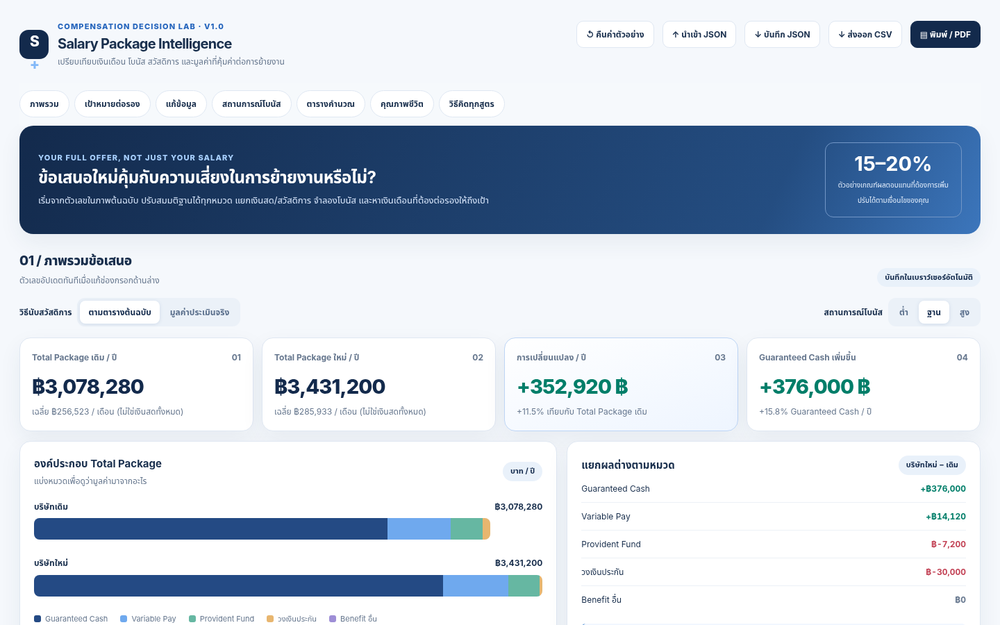

# Salary Package Intelligence — V1.0

**Interactive Total Compensation / Salary Negotiation Dashboard** ที่ใช้งานได้จริงผ่านเบราว์เซอร์แบบ Static HTML โดยไม่ต้องใช้ Backend หรือฐานข้อมูล



## เริ่มใช้งานทันที

- เปิด `index.html` ใน Chrome / Edge / Safari ได้โดยตรง
- หรือเผยแพร่ผ่าน GitHub Pages ตามหัวข้อด้านล่าง
- เปลี่ยนตัวเลขได้ทั้งบริษัทเดิมและข้อเสนอใหม่ ระบบคำนวณใหม่ทันที
- ไม่ต้องใช้ Node.js, npm, API key, package install หรือ database

## Deploy บน GitHub Pages (อัตโนมัติ)

1. สร้าง GitHub Repository ใหม่ เช่น `salary-package-intelligence` (จะ Public หรือ Private ขึ้นกับสิทธิ์ GitHub Pages ของบัญชี)
2. แตก ZIP และ **อัปโหลดไฟล์และโฟลเดอร์ภายในแพ็กเกจทั้งหมด** ไปไว้ที่ราก Repository — ห้ามอัปโหลด ZIP เพียงไฟล์เดียว เพราะ GitHub Pages ไม่แตก ZIP ให้อัตโนมัติ
3. ตั้ง default branch เป็น `main` หรือสร้าง `main` และ Commit ไฟล์ทั้งหมด
4. ใน Repository ไปที่ **Settings → Pages → Build and deployment → Source: GitHub Actions**
5. ไปที่แท็บ **Actions** เพื่อตรวจ workflow `Deploy Salary Package Dashboard to GitHub Pages` (หากยังไม่รันให้เลือก `Run workflow`)
6. เมื่อ Deploy สำเร็จ เว็บไซต์จะมีรูปแบบ URL `https://<username>.github.io/<repository>/`

> **สำคัญ:** Workflow ไม่ได้ทำให้ Repository ถูกสร้างขึ้นเอง และแพ็กเกจนี้ไม่ได้อัปโหลดเข้าบัญชี GitHub ให้โดยอัตโนมัติ

### วิธีใช้ Git CLI (ทางเลือก)

เปิด Terminal ในโฟลเดอร์ที่แตก ZIP แล้วรัน:

```bash
git init
git add .
git commit -m "Initial release: Salary Package Intelligence V1.0"
git branch -M main
git remote add origin https://github.com/YOUR_USERNAME/salary-package-intelligence.git
git push -u origin main
```

ต้องสร้าง Repository ปลายทางบน GitHub ก่อน และต้องมีสิทธิ์ Authenticate / Push

## ฟีเจอร์

| หมวด | รายละเอียด |
|---|---|
| Salary & Fixed | เงินเดือน, เดือนที่จ่ายเงินเดือน, โบนัสรับประกัน |
| Allowances | ค่าเดินทาง, โทรศัพท์, ค่าใช้จ่ายอื่นต่อเดือน/ต่อปี |
| Variable | โบนัสแบบเปอร์เซ็นต์/เดือน/ระบุยอด, Commission, Incentive |
| Bonus Scenarios | Low / Base / High และ Expected Value ตามความน่าจะเป็นที่กำหนด |
| Benefits | PVD สมทบนายจ้าง, ประกัน, สวัสดิการอื่น |
| Negotiation | หาเงินเดือนที่ทำให้ Total Package ถึงเป้าหมาย % |
| Lifestyle | เปรียบเทียบวันลา, WFH, เวลาการเดินทาง และต้นทุนการย้ายงาน |
| Exports | Import / Export JSON, CSV และ Print PDF ผ่าน Browser |

## ข้อมูลตัวอย่างจากตารางต้นฉบับ

| รายการ | บริษัทเดิม | บริษัทใหม่ |
|---|---:|---:|
| Base Salary / เดือน | 182,000 | 220,000 |
| เงินเดือน + โบนัสรับประกัน / ปี | 2,366,000 | 2,640,000 |
| รวม Fixed Allowance และรายได้การันตี / ปี | 2,384,000 | 2,760,000 |
| รวม Variable / ปี | 2,809,880 | 3,200,000 |
| **Total Package ตามวิธีต้นฉบับ** | **3,078,280** | **3,431,200** |

ส่วนต่าง = **352,920 บาท/ปี (+11.46%)**

อธิบายสูตรและข้อควรระวังเพิ่มเติม: [docs/FORMULAS.md](docs/FORMULAS.md)

## Privacy / ความปลอดภัย

- ข้อมูลบันทึกอยู่ใน `localStorage` **ของเบราว์เซอร์และอุปกรณ์นั้น** ไม่ได้ Sync ข้ามอุปกรณ์
- Static app ไม่มี server-side collection หรือ API upload ของข้อมูลค่าตอบแทน
- การเปิดผ่าน GitHub Pages ไม่ได้หมายความว่าข้อมูลส่วนตัวที่กรอกจะถูก push ไป GitHub
- **อย่านำไฟล์ JSON/CSV ที่ Export ซึ่งมีข้อมูลเงินเดือนจริงขึ้น GitHub โดยเฉพาะ Repository สาธารณะ**
- เมื่อเคลียร์ browser storage อาจสูญเสียข้อมูลที่แก้ไขไว้ — Export JSON เพื่อ Backup

## ตรวจสอบสูตรก่อนเผยแพร่

```bash
node tests/verify.mjs
```

GitHub Actions จะรัน Regression Test นี้ก่อน Deploy ทุกครั้ง ถ้าทดสอบไม่ผ่านจะไม่เผยแพร่เว็บเวอร์ชันนั้น

## Notes

- Dashboard แสดง Gross Compensation **ก่อนภาษี** ยังไม่ใช่ Net Take-home Pay
- โบนัส Variable เป็นสมมติฐาน ไม่ใช่รายได้ที่รับประกัน
- มูลค่าวงเงินคุ้มครองประกันสุขภาพ ไม่ใช่เงินสดและไม่ใช่ค่าเบี้ยประกันจริง
- ค่าใช้จ่ายในการเดินทางและความเสี่ยงในการปรับตัวต้องประเมินแยกจากยอด Gross Package

## Structure

```text
.
├── index.html                 # Dashboard แอปตัวจริง แบบ Single File
├── .nojekyll                  # รองรับไฟล์ static บน GitHub Pages
├── .gitignore                 # ป้องกันไฟล์ชั่วคราวและ Export บางชื่อ
├── .github/workflows/
│   └── deploy-pages.yml      # Auto-deploy ทุกครั้งที่ push main
├── assets/
│   ├── dashboard-desktop.png
│   └── dashboard-mobile.png
├── docs/
│   └── FORMULAS.md
├── tests/
│   └── verify.mjs            # Regression test (node tests/verify.mjs)
└── README.md
```

**License:** ยังไม่ได้กำหนดสิทธิ์การใช้งานซอร์สโค้ดเป็น Open Source; ผู้เป็นเจ้าของ Repository สามารถเลือก License ที่เหมาะสมในภายหลัง
